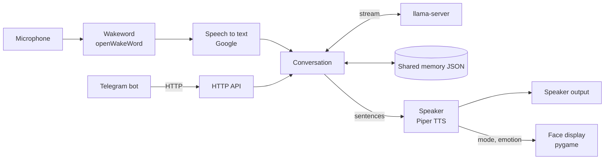

# Morgana

A voice companion that runs on a Raspberry Pi 5 with a small touchscreen. Say the
wakeword, ask something, and Morgana answers out loud while an animated face reacts.
Replies come from a 1.5B-parameter LLM running locally on the Pi, and the
conversation memory is shared with a companion Telegram bot.


## Features

- **Custom wakeword** detection with [openWakeWord](https://github.com/dscripka/openWakeWord).
- **Local LLM** (Qwen2.5-1.5B through `llama-server`). Speech-to-text uses Google's
  web recognizer through [SpeechRecognition](https://github.com/Uberi/speech_recognition).
- **Streaming speech**: each sentence is synthesized with [Piper](https://github.com/OHF-Voice/piper1-gpl)
  and played while the model is still generating the next one. When little audio
  is queued, long sentences are spoken clause by clause so playback never runs dry.
- **Long-term memory**: lasting facts ("my brother Leo plays guitar") are pinned
  into the system prompt. A regex gate and a grounding check stop the small model
  from inventing facts.
- **KV-cache-friendly prompts**: the history window moves in steps, and the
  next prompt is pre-evaluated after each reply, so llama-server can reuse its cache.
- **HTTP gateway** for the Telegram bot: it can relay messages for a spoken reply
  or trigger spoken wellness reminders.
- **Per-stage latency logging** from wakeword to first audio, which guided the
  performance work.

## Architecture



| File | What it does |
| --- | --- |
| `assistant.py` | Wakeword loop, and taking turns between voice, Telegram and reminders |
| `llm.py` | Streams replies from llama-server and splits them into sentences to speak |
| `audio.py` | Microphone input, Piper TTS, and playing one sentence while synthesizing the next |
| `memory.py` | Shared JSON memory, prompt building, and pinning facts about the user |
| `api.py` | Small HTTP API for the Telegram bot |
| `face.py` | Animated face on the display |
| `state.py` | State shared between threads, plus a stopwatch for latency logs |
| `config.py` | Settings, read from the environment or `.env` |

## Setup

Hardware: Raspberry Pi 5 (8 GB), a USB microphone, speakers, and an 800x480 display.

```bash
sudo apt install portaudio19-dev
python -m venv agent_env && source agent_env/bin/activate
pip install -r requirements.txt
cp .env.example .env        # then edit paths and the microphone name
```

You also need:

- [llama.cpp](https://github.com/ggml-org/llama.cpp) built with `llama-server`, plus a GGUF model
  such as `qwen2.5-1.5b-instruct-q4_k_m.gguf`.
- A Piper voice at `models/v2.onnx` with its `models/v2.onnx.json` config.
- Optionally, a cue sound at `assets/sounds/got_it.wav`, played when the wakeword fires.

## Running

```bash
scripts/start_local_llm.sh   # terminal 1: local model server on :8080
python -m morgana            # terminal 2: the assistant
```

Press <kbd>Ctrl</kbd>+<kbd>`</kbd> to toggle fullscreen.

To measure model latency, run `python -m scripts.benchmark_llm`.

## HTTP API

The gateway listens on `127.0.0.1:8643` by default and has no authentication.

| Method | Path | Body | Response |
| --- | --- | --- | --- |
| `GET` | `/api/health` | | `{"status": "ok", "port": 8643}` |
| `GET` | `/api/status` | | `{"agent_state", "current_emotion", "pings_sent", "ok"}` |
| `POST` | `/api/chat` | `{"text": "..."}` | `{"reply", "emotion"}`; the reply is also spoken |
| `POST` | `/api/tts` | `{"text": "...", "emotion": "happy"}` | `{"spoken": true, ...}` |

## Tests

```bash
pip install pytest requests
pytest
```
